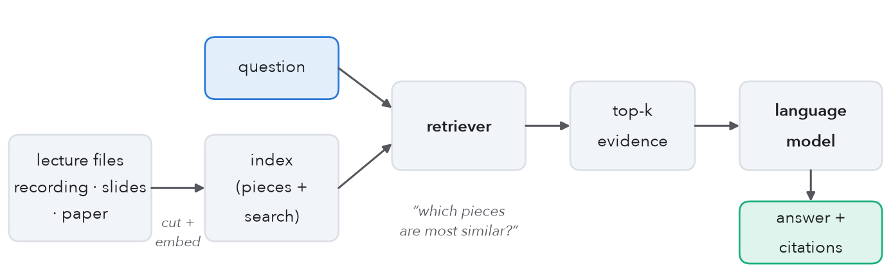
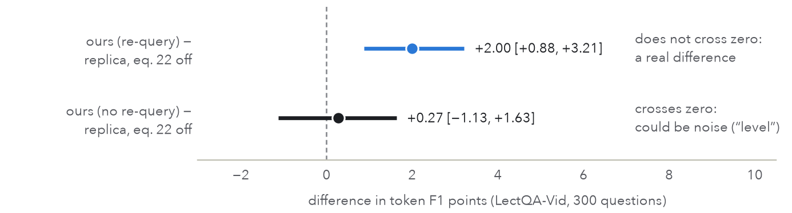
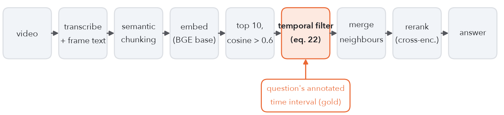
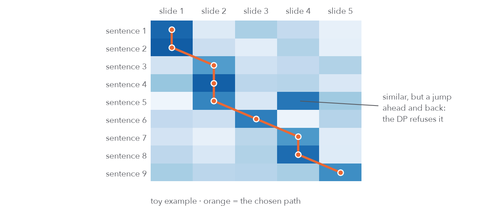
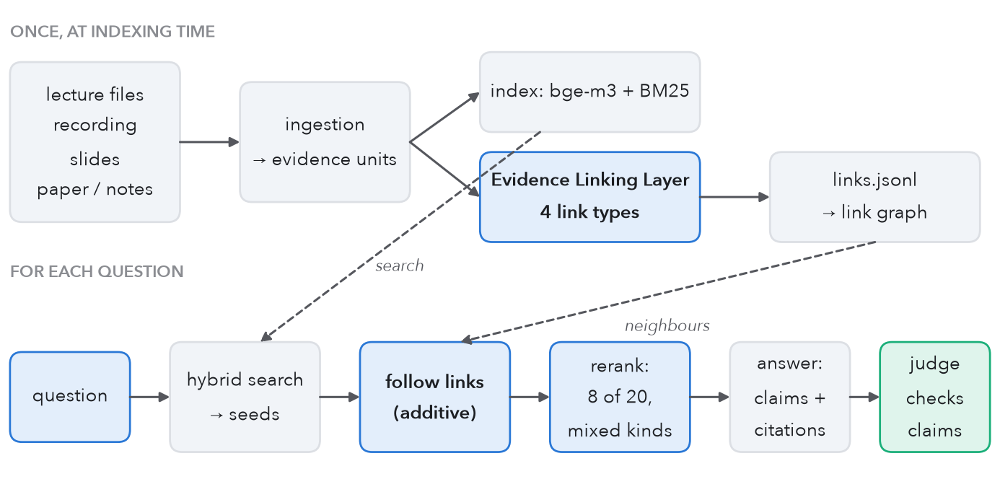
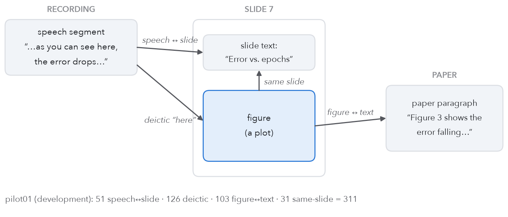
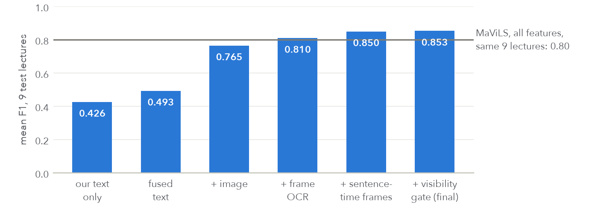
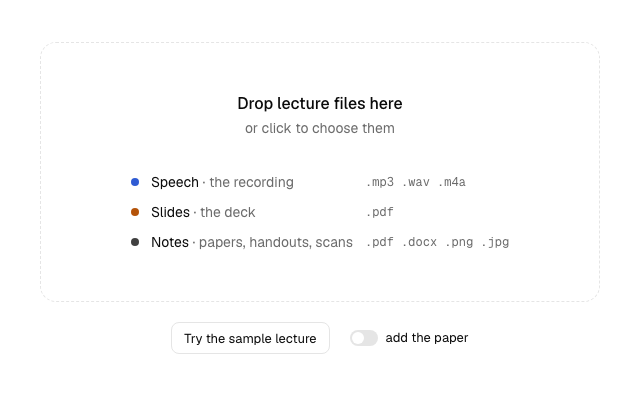
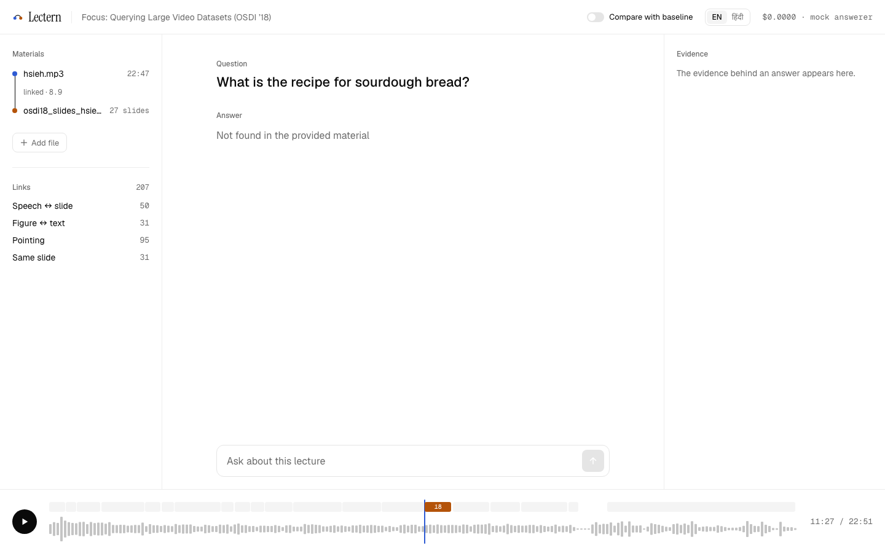

# LinkRAG — study guide

A guide to the whole project, written so that you can explain it to your mentor and answer her questions. It is built from the repository itself: `DESIGN.md`, `README.md`, the result files in `results/external/`, `reports/results_vs_target_papers.md`, `reports/project_review_2026-09-25.md`, `reports/perf_2026-09-27.md` and the code. Every number comes from one of those files. Where a number is not in them, the text says [TODO] instead of guessing.

How to read it: chapters 1, 7, 8 and 14 are the ones to know by heart. Chapter 2 and the glossary (chapter 13) explain every term. Each chapter ends with an "If ma'am asks…" box of likely questions and short, honest answers.

# 1. The project in one page

## 1.1 The problem

A university lecture comes as several files: a **recording** (what the teacher said), a **slide deck** (what was shown) and often **notes or a paper** (what is written down). A student who asks "what did the teacher mean by this diagram?" needs all three at once. The answer may be half in the speech and half in the slide.

Most question-answering systems treat each file separately. They cut everything into small pieces, find the pieces most similar to the question, and hand them to a language model. Nothing connects the sentence the teacher said to the slide that was on screen at that moment.

## 1.2 What RAG is

**RAG (retrieval-augmented generation)** means: first *retrieve* the relevant pieces of your documents, then let a language model *generate* an answer from only those pieces. Analogy: an open-book exam. The student (the language model) may only use the pages the librarian (the retriever) hands over, and should quote them.



## 1.3 What we built

LinkRAG is a RAG system for lectures. Its central idea is an **Evidence Linking Layer**: when the lecture is indexed, the system builds explicit links between pieces of different files — a speech segment to the slide it talks about, a figure to the paragraph that explains it, "as you can see here" to the figure being pointed at. At question time, retrieval can *follow* these links from the best matches, and a reranker picks a set of evidence that covers several kinds of material rather than eight near-copies of one.

Around this we built everything a research project needs to be trusted: ingestion of PDF, Word, images, audio and video; a search index; grounded answers with citations; a checker that tests every claim of an answer against the evidence it cites; evaluation tools; a cost ledger with hard spending caps; and a web app called **Lectern**.

## 1.4 The two target papers

The mentor's rule was: report results only on the datasets of the papers we try to improve on.

*Table: The two target papers.*

| | Paper | Benchmark (dataset) | Their headline number |
|---|---|---|---|
| T1 | Intra-Video Temporal-Aware RAG (Shafiq et al., *CMC* 2026) | **LectQA-Vid**: 100 short CS lecture videos, 3,000 questions | open-ended token F1 23.52; MCQ accuracy 53.43 |
| T2 | MaViLS (Anderer, Reich, Wölfel, *Interspeech 2024*) | **MaViLS**: 20 lectures; every spoken sentence labelled with its slide | alignment F1 0.53 from speech only; 0.82 with all features |

## 1.5 The headline results, one sentence each

- **LectQA-Vid (T1):** with the same answering model for everyone, in a controlled re-implementation, our retrieval with one re-query scores +2.00 F1 points above our rebuild of T1's pipeline (with its timestamp filter switched off), 95 % confidence interval [+0.96, +3.11] when whole videos are resampled (`results/external/lectqa_recheck.md`). The re-query is MI-RAG's technique, not ours, and it carries +1.74 of the +2.00.
- **But:** giving the model the **whole transcript** beats every retrieval method (38.74 F1 against 36.70 for ours), because every LectQA-Vid transcript is short enough to fit in the model's input. This benchmark therefore cannot measure what retrieval is worth.
- **LectQA-Vid multiple choice:** not a fair test — the correct option is option A in 99.7 % of the published questions, and "pick the longest option" scores 94.4 % without watching anything.
- **MaViLS (T2):** our slide alignment scores **0.853 against their 0.80** on the same 9 held-out lectures; the difference (+0.055, 95 % CI [−0.050, +0.161]) is inside the noise, so we call it **parity**, not a win.

## 1.6 What it cost

The project ledger (`reports/llm_ledger.jsonl`, kept on your machine) records **$23.21** of API spend over 64 priced rows (September 21–27, 2026). Six more rows have no price attached (five with gpt-5.4, one free Groq call), so the real total is somewhat higher. The account's billing dashboard showed about $19 on 2026-09-25 (as you reported it; the review notes the ledger over-counts because it ignores OpenAI's automatic cache discount). All MaViLS work, all re-checks and this guide cost $0.

> **If ma'am asks…**
>
> **Q: What is new in your project, in one sentence?** A: The Evidence Linking Layer — links between the recording, the slides and the notes, built before any question is asked, so retrieval can follow them.
>
> **Q: Did you beat the papers?** A: On LectQA-Vid our retrieval beats a faithful rebuild of T1's pipeline by 2.0 F1 points (interval +0.9 to +3.2). But the whole transcript beats every retrieval method, so that benchmark cannot show retrieval is useful. On MaViLS we are level with them (0.853 vs 0.80, inside the noise).
>
> **Q: Then what are your real contributions?** A: The corrected replication and comparison on LectQA-Vid, an audit that found serious flaws in that benchmark, a slide-alignment method at parity with MaViLS (our decoder is at least as good as theirs), and claim-level checking of answers.
>
> **Q: Did the linking layer itself help?** A: Not on a reported benchmark. LectQA-Vid has one video per question and no separate slides or notes, so there is nothing to link across. The only positive evidence is on our development lecture, which is too small to report.

# 2. Background concepts

Each section below explains one idea the rest of the guide uses. Read them once; come back when a term is unclear.

## 2.1 RAG

Retrieval-augmented generation (section 1.2): retrieve evidence first, then answer only from it. Why not just ask the model? A language model on its own may invent facts ("hallucinate", section 2.9) and cannot see your private lecture files. RAG gives it the right pages and asks it to cite them.

## 2.2 Chunking

**Chunking** is cutting documents into pieces small enough to search and to fit in the model's input. Analogy: cutting a book into index cards. In LinkRAG a piece is called an **evidence unit**: a paragraph of a PDF, a figure, a slide, or about 30 seconds of speech (15 seconds for the short LectQA-Vid videos). We cut speech at the ends of sentences, never mid-sentence (config `ingest.audio_segmentation: sentence`).

## 2.3 Embeddings and vector search

An **embedding** turns a piece of text into a list of numbers (a vector) so that texts with similar meaning get similar vectors. Analogy: giving every book a position on a huge map, where books about similar things sit close together. **Vector search** finds the units whose vectors are closest to the question's vector, usually by **cosine similarity** (how closely two arrows point the same way; 1 = same direction). We use the embedding model **bge-m3**, and search exactly (we compare the question with every unit; with a few hundred units this takes milliseconds).

## 2.4 BM25 keyword search

**BM25** is a classic keyword-matching score. A unit scores high when it contains the question's words, especially rare words, and is not padded with other text. Analogy: a librarian scanning for the exact words you said, paying most attention to the unusual ones. BM25 catches exact terms (names, numbers, jargon) that embeddings can blur.

## 2.5 Hybrid search

**Hybrid search** runs both searches and merges their ranked lists. We merge with **RRF (reciprocal rank fusion)**: each unit gets 1/(60 + its rank) from each list, summed. Analogy: two judges each rank the candidates; a candidate both judges put near the top wins, even if neither put it first. (`retrieve.rrf_k: 60`.)

## 2.6 Reranking

A **reranker** looks again at a pool of candidates (for us, 20) and chooses the final few (8) to give the model. A **cross-encoder** reranker reads the question and each candidate together and scores how well they match; T1 uses one. Our **complementarity reranker** instead scores the *set*: it rewards adding a new kind of material (speech, slide, paper) or a unit linked to one already chosen, and penalises near-duplicates. Analogy: picking a team, not the eight individually best players who all play the same position.

## 2.7 The language model as answerer

The **answerer** is the language model that writes the answer from the evidence. Ours is gpt-5.4-mini (dated snapshot 2026-03-17) at temperature 0 (the most repeatable setting). It must answer in a fixed JSON shape: an answer plus a list of **claims**, each citing the units it rests on. If the evidence does not contain the answer, it must say "not found in the provided material" — that is called **abstaining**.

## 2.8 The language model as judge

A **judge** is a second language model that checks work instead of answering. Ours is gpt-4.1-mini (snapshot 2025-04-14), deliberately a different model from the answerer, because a model grading itself is lenient. The judge decides, for each claim, whether a cited unit really states it, and must quote the supporting span.

## 2.9 Hallucination

A **hallucination** is a claim the model states that its evidence does not support. We measure the **hallucination rate** as unsupported claims divided by all claims. It is not the same as a wrong answer: a claim can be supported by the evidence and still be wrong if the evidence is wrong.

## 2.10 Multimodal

**Multimodal** means more than one kind of material: text, images, audio, video. A lecture is multimodal by nature. In LinkRAG every unit has a **modality** (text, figure, audio), and we report the mix of modalities in every retrieved set.

## 2.11 ASR and Whisper

**ASR (automatic speech recognition)** turns speech into text with a time stamp for every word. We use **faster-whisper** (a fast version of OpenAI's Whisper model, size "small", on the CPU). Analogy: an automatic stenographer who also notes when each word was spoken. We **freeze** transcripts: once made, a transcript is saved and reused, because re-running speech recognition can change the words.

## 2.12 OCR

**OCR (optical character recognition)** reads the text inside an image — a slide screenshot, a scanned page, a video frame. We use **tesseract**. It is fast and free but struggles with small, blurry or stylised text.

## 2.13 Two statistics you will be asked about

**F1.** For answers, **token F1** compares the words of our answer with the words of the reference answer: precision (how many of our words are in the reference) and recall (how many reference words we produced), combined as their harmonic mean. 100 means word-for-word identical. For slide alignment, F1 measures how many sentences got the right slide.

**Confidence interval (CI).** A range that shows how sure we are about a number measured on a sample. "+2.00 [+0.88, +3.21]" means our best estimate is +2.00 and, with 95 % confidence, the true difference lies between +0.88 and +3.21. **If the interval does not contain 0, the difference is real at that confidence; if it contains 0, it could be noise.**

**Bootstrap.** How we got those intervals. We take our 300 questions and draw 300 at random *with replacement* (some repeat, some are left out), recompute the average difference, and repeat 10,000 times. The middle 95 % of those 10,000 averages is the interval. Analogy: re-running the exam many times with a slightly different set of questions each time, to see how much the result wobbles.

**Kappa (κ).** Agreement between two judges, corrected for agreement by chance. 1 = perfect agreement, 0 = no better than chance. Our two language-model judges agreed at κ = 0.85 on the development lecture; a small local NLI model reached only 0.31 against them, so we did not use it as the checker (DESIGN finding 11).



> **If ma'am asks…**
>
> **Q: Why use both embeddings and BM25?** A: Embeddings find the same meaning in different words; BM25 finds exact rare words like names and numbers. Merging both is more robust than either.
>
> **Q: Why a separate judge model?** A: A model grading its own answers is lenient. The judge is a different model, and it must quote the span that supports each claim.
>
> **Q: What does the bootstrap interval tell me?** A: How much the result would change with a different sample of questions. If it excludes zero, the difference is unlikely to be luck.
>
> **Q: Temperature 0 — is it fully deterministic?** A: Almost, not fully. That is why every result that uses a language model was run three times and reported as mean ± standard deviation.

# 3. Target paper 1: Intra-Video Temporal-Aware RAG and LectQA-Vid

## 3.1 Their problem

T1 (Shafiq, Ejaz, Shah, Kamal, Sohail, Aslam; *CMC* 88(2), article 96, 2026) answers questions about a single lecture video. Their idea is that *when* something is said matters: evidence should come from the right moment of the video.

## 3.2 Their method, step by step

1. **Transcribe and caption.** Whisper transcribes the speech; video frames are described by captions (the repository notes they used Gemini captions; we used tesseract OCR instead).
2. **Semantic chunking.** Consecutive sentences are merged while they are similar (cosine above 0.75) and close in time (gap under 5 seconds). Near-duplicates (cosine above 0.9) are dropped. Frame text that overlaps speech by more than 2 seconds is suppressed, because speech takes priority.
3. **Embed** the chunks with "BGE base" (we used BAAI/bge-base-en-v1.5, mean-pooled).
4. **Retrieve** the top 10 chunks with cosine above 0.6.
5. **Temporal filter (their equation 22).** Keep only chunks that overlap the question's annotated time interval, widened by ±3 seconds.
6. **Merge** results that are next to each other in time.
7. **Rerank** with a cross-encoder and keep the best few, in time order.
8. **Answer** with a language model.



The crucial detail is step 5. The paper does not say where the filter's time interval comes from when a real user asks a question. The only intervals it describes are the dataset's annotations of *where the answer is*, so our rebuild gives the filter those. That is like being told which page of the book the answer is on, and a real user would not have it. The paper also does not say what happens when the filter leaves nothing; our rebuild then gives a fixed "no evidence" reply. Both are our choices, and the comparison we report switches the filter off. *Corrected 2026-11-12: this said "We call it an oracle filter", as if the paper stated that it reads the annotation.*

## 3.3 Their dataset: LectQA-Vid

LectQA-Vid has 100 computer-science lecture videos of 2–5 minutes and 3,000 question–answer pairs: 1,500 multiple choice (MCQ) and 1,500 open-ended, each labelled simple, hard or very hard. Their split is 80/10/10 with a 1,000-pair evaluation subset (500 MCQ + 500 open-ended), but the split and the subset are not published. The videos are YouTube links; the dataset ships the questions, answers and time stamps only.

## 3.4 Their metrics

For open-ended answers they report token F1, semantic similarity (cosine of all-MiniLM-L6-v2 sentence embeddings), BLEU, METEOR and ROUGE-1 (their equations 29–35), all in %. For MCQ they report accuracy (equation 36). We re-implemented all of them in `src/linkrag/eval/lectqa_metrics.py`, checked against hand-computed examples in the tests.

## 3.5 Their published numbers

*Table: T1's published results (their Tables 4 and 5). Their answering model is not named.*

| level | F1 | Sim | BLEU | METEOR | ROUGE-1 | MCQ accuracy |
|---|---:|---:|---:|---:|---:|---:|
| simple | 29.47 | 77.23 | 8.61 | 38.15 | 36.82 | 57.29 |
| hard | 24.38 | 74.56 | 5.29 | 34.71 | 30.94 | 52.34 |
| very hard | 16.72 | 71.48 | 2.83 | 24.36 | 22.51 | 50.67 |
| **overall** | **23.52** | **74.42** | **5.58** | **32.41** | **29.76** | **53.43** |

Two more: their multimodal RAG without time stamps scores F1 14.80 (Table 6), and removing the temporal filter drops F1 to 11.40 (Table 7).

## 3.6 Their limitations, as they state them

[TODO: the repository does not record the limitations section of the T1 paper, so this guide cannot quote it. What the repository records are the gaps we found: the answering model is not named, the split and evaluation subset are not published, and several pipeline settings (the rerank pool size, the context size, the merge gap, the cross-encoder, the index layout) are not stated.]

> **If ma'am asks…**
>
> **Q: What is T1's main idea?** A: Restrict retrieval to the right moment of the video, using time stamps, then rerank with a cross-encoder.
>
> **Q: What is wrong with their temporal filter?** A: The paper does not say where the filter's time interval comes from at question time. Our rebuild gives it the question's annotated interval — where the answer is — which a real user does not have. On our rebuild it also leaves 34 questions with no context at all; our fixed reply there costs 2.93 F1, and elsewhere the filter makes no measurable difference.
>
> **Q: Can you compare your F1 with their 23.52 directly?** A: No. They do not name their answering model, and their evaluation subset is unpublished. We compare only methods that use the same answerer, on the same questions.
>
> **Q: Why did you rebuild their pipeline instead of using their code?** A: Their code is not published. We rebuilt it from the paper's equations and Table 3 values, and wrote a unit test for each step.

# 4. Target paper 2: MaViLS

## 4.1 The task: slide–speech alignment

**Alignment** means deciding, for every spoken sentence of a lecture, which slide was being talked about. Analogy: putting subtitles on the right page of a flip chart. It is exactly our `audio_slide` link type, so MaViLS is the benchmark for that part of the linking layer.

## 4.2 Their three features

MaViLS compares each moment of the lecture with each slide in three ways, giving three similarity tables (matrices):

1. **Speech text vs slide text** — the transcript against the slide's words. In their public code this is the cosine of a multilingual sentence-embedding model (distiluse-base-multilingual-cased).
2. **OCR text** — the text read from the video frame against the slide's text.
3. **Image** — the video frame against a picture of the slide, compared with an image model (SwiftFormer).

## 4.3 Their decoder: dynamic programming

**Dynamic programming (DP)** solves a big problem by building on answers to smaller ones. Analogy: planning the cheapest train route city by city, keeping only the best route to each city. Here the "route" goes through the lecture sentence by sentence, choosing a slide for each. The score is the similarity of each choice, minus a **jump penalty** (λ_jump = 0.1) for moving between slides, because teachers usually go through slides in order. The DP finds the best overall path, not just the best slide for each sentence alone.



## 4.4 Their dataset and metric

MaViLS has 20 lectures (from MIT OpenCourseWare, the University of Tübingen and DeepMind), over 22 hours of video and 12,830 segments. Every spoken sentence is labelled with its slide number, or −1 when no slide applies. The score is an F1 over sentences: for each lecture, the share of labelled sentences given the right slide (scikit-learn's micro-averaged F1, ignoring rows labelled −1), then the plain average over lectures.

## 4.5 Their results

*Table: MaViLS' published averages over their 20 lectures.*

| features | F1 |
|---|---:|
| audio transcript only | 0.53 |
| OCR text only | 0.76 |
| image only | 0.64 |
| SIFT baseline (an older image-matching method) | 0.56 |
| all three combined (λ_jump = 0.1) | **0.82** |

On the 9 lectures we tested on (section 8.1), their published per-lecture numbers average **0.47** audio-only and **0.80** with all features.

> **If ma'am asks…**
>
> **Q: Why is MaViLS relevant to a question-answering project?** A: Our linking layer's first and most important link, speech-to-slide, is exactly their alignment task. MaViLS is how we measure that component.
>
> **Q: Is the DP your invention?** A: No. MaViLS already uses DP with a jump penalty; we say so in DESIGN.md. Ours adds skip and backward-jump penalties, a start prior, a relatedness gate and abstention, and a faster computation.
>
> **Q: Which of their features matters most?** A: OCR text alone gives them 0.76 and the combination 0.82; the transcript alone only 0.53. The video frames carry most of the signal — the same thing we found.

# 5. Our system, module by module

LinkRAG is a Python package in `src/linkrag/`. Every stage exposes two modes: **baseline** (what ordinary multimodal RAG does: separate files, plain top-k, no links) and **linkrag** (ours). Both run from the same code and the same settings, so any difference between them is the effect of our mechanism. DESIGN.md calls this the *two-mode rule*.

The numbers in this chapter come from **pilot01**, our development lecture: Hsieh et al.'s talk on *Focus* (OSDI '18), a 22.9-minute recording, a 27-slide deck and the 19-page paper. It is only for building and debugging; by the dataset policy it never appears in a reported result.



## 5.1 Ingestion

*Files:* `src/linkrag/ingest/` (`pdf.py`, `docx.py`, `image.py`, `audio.py`, `asr_openai.py`, `video_slides.py`).

Ingestion turns every file into evidence units, each with its file name and location (page and box on the page, or start and end time).

- **PDF.** PyMuPDF reads text blocks with their position on the page, then cuts them into chunks of about 300 tokens. A deck (landscape pages) and a paper (portrait pages) are told apart by page shape. pilot01 gives 111 text units: 84 from the paper, 27 from the deck.
- **Figures in slides.** Slides usually draw plots as vector shapes, which a normal image extractor cannot see. We cluster drawing operations and image boxes into figure regions (`cluster_deck_figures`). On pilot01 this raised deck figures from 18 to 31, and slides with a figure from 11 of 27 to 24 of 27.
- **Figures in papers.** Papers put a caption under each figure; we find the captions and cut the figure region above them (`figures_from_captions`). The paper has 13 captioned figures; plain image extraction had found only 2, both logo fragments.
- **Figure text.** Slide figures have no caption, so we OCR the figure image itself (`ocr_figures`). Before this, 13 of 18 deck figures had no text at all.
- **DOCX and images.** Word files become text units; standalone images become figure units through OCR.
- **Audio.** faster-whisper transcribes with a time stamp per word. We cut units at sentence ends and pack whole sentences into windows of about 30 seconds. Fixed 30-second windows would cut 32 of 46 boundaries (70 %) mid-sentence; sentence packing cuts 0 of 53.
- **Video.** For LectQA-Vid we rebuild a "deck" from the video frames (`video_slides.py`): one frame per second, grouped into slides by a picture fingerprint (dHash), with OCR on each. Over the 95 videos this gave 2,175 slides, about 23 per video.

## 5.2 The index

*File:* `src/linkrag/index/__init__.py`.

Every unit is embedded with bge-m3 and also indexed for BM25. A question is searched both ways and the two ranked lists are merged with RRF (section 2.5). pilot01 has 209 units: 111 text, 47 figure, 51 audio. The index records a **manifest hash**, a fingerprint of exactly which files and settings built it, so links or gold answers built for a different version are refused.

## 5.3 The evidence linking layer

*Files:* `src/linkrag/link/` (`align.py`, `figure_text.py`, `deictic.py`, `same_slide.py`, `graph.py`, `pipeline.py`, `visual.py`, `relatedness.py`).

The linking layer builds four types of link, each with a score. On pilot01 it builds 311 links: 51 speech↔slide, 126 deictic, 103 figure↔text and 31 same-slide.



**Speech ↔ slide (alignment).** For each recording and each deck, we build a similarity table (sentence × slide) from embeddings, BM25 and shared rare words, then run a DP (section 4.3) to choose a slide for every speech segment. Our DP has four penalties: for jumping ahead several slides (0.05 per slide), for slides never used (0.02), for going backwards (0.15 per slide, at most 2 slides back), and a small pull of the first segment towards slide 1 (the *start prior*, 0.02). On pilot01, measured against a hand-made timeline of which slide was on screen, the DP gets 32 of 42 segments right (76.2 %) against 24 of 42 (57.1 %) for picking the best slide per segment alone. (This is optimistic: the start prior was tuned on the same 42 labels.)

Two safety checks sit on top:
- **Relatedness gate.** Before linking a recording to a deck, we check that they belong together: the real alignment's score must beat 30 alignments with the slides shuffled into random order by at least 1.27 standard deviations (a **z-score**, how many "typical wobbles" above chance). If not, no links are made. On 380 unrelated MaViLS pairs this setting wrongly accepts 4.7 % and wrongly rejects 15 % of related ones (finding 7). A pilot01 recording against an unrelated deck gets 0 cross-file links.
- **Abstention.** A segment whose best similarity is too low can be left unlinked (config `min_segment_sim`, off by default).

**Figure ↔ text.** A figure links to paragraphs that mention it ("Figure 3"), sit next to it, are on a nearby page, or are similar in meaning. Links between two different documents that rest only on meaning (no explicit "Figure 3") must first pass a document-level gate, the same shuffle-based test with the words scrambled. 103 links on pilot01; the relatedness check passes all of them, but partly trivially, since slide titles repeat in the OCR text.

**Deictic "this/here".** *Deixis* is pointing with words: "this arrow here", "as you can see". We find such phrases in the transcript and link them to a figure on the slide being shown at that moment. Phrases get **tiers**: tier 1 names an object ("this arrow here", weight 1.0), tier 2 is a pronoun with a visual word nearby (0.6), tier 3 a bare "this" or "that" (0.3). Against hand-labelled pointing windows: precision 12 of 15 (80 %), recall 12 of 14 (86 %).

**Same slide.** A figure is linked to the text of its own slide, with score 1.0: being on the same page is certain.

The links are stored in `links.jsonl` with the manifest hash, and loaded into a graph (networkx) that retrieval walks.

## 5.4 Retrieval modes

*Files:* `src/linkrag/retrieve/` (`baseline.py`, `iterative.py`, `linkrag.py`).

- **baseline**: hybrid search, plain top-k.
- **iterative**: our version of the re-querying idea from MI-RAG. The model reads the first results and writes one follow-up search query; the two rounds are merged (2 rounds, 8 per round).
- **linkrag**: take the top seeds, then add their 1-hop link neighbours to the candidate pool. A neighbour's score is the seed's score × the link's score × 0.5. Seeds are rank-normalised first, so seeds and neighbours are on one scale. Expansion is *additive*: it never throws a seed out.
- **linkrag_iter**: iterative seeds, then link-following.

A design change is worth knowing: an early version filled the last slots with link neighbours unconditionally, evicting seeds ranked 6–8. On one development question (A1) that dropped the gold evidence from 100 % to 0 %. The fix, additive expansion, is kept with a switch that reproduces the old behaviour (`retrieve.expansion: evict`).

## 5.5 The complementarity reranker

*File:* `src/linkrag/retrieve/rerank.py`.

From a pool of 20 candidates it picks 8 one at a time. Each step it adds the candidate with the best score + 0.3 if it brings a new modality + 0.2 per link into the already-chosen set − 0.4 × its similarity to a chosen unit of the same modality. Alternatives for comparison: `none` (plain top-k) and `mmr` (a standard diversity method).

## 5.6 Grounded answers, citations and claim checking

*Files:* `src/linkrag/generate/` (`answer.py`, `citations.py`, `verify.py`).

The answerer returns JSON: an answer plus claims, each citing unit ids. `citations.py` turns a cited unit into something a reader can open: a crop of the PDF page, the figure image, or an audio clip of those seconds. `verify.py` checks every claim against the text of the units it cites: the judge runs 3 times, the majority decides, and a supporting quote must exist in the text. Claims are marked *supported*, *weak* (cites nothing) or *unsupported*. In strict mode unsupported claims are hidden, and if none survive, the system abstains.

## 5.7 The evaluation machinery

*Files:* `src/linkrag/eval/`, `src/linkrag/costs.py`, `scripts/`.

- **Gold groups.** For pilot01, the "gold" evidence of each question is stored as locations (file + page, or file + time), never as unit ids, because ids change when chunking changes.
- **Automated gold verification** (`eval/verify_gold.py`). The judge checks every proposed gold unit (3 runs, majority, quote required) and checks whether each question is answerable from a single source or needs several. On pilot01: 25 of 25 questions kept, 69 of 147 proposed gold units kept, 4 genuinely cross-modal questions. Judge and answerer agree on unit verdicts at κ = 0.85.
- **Judge tiers.** The cheap judge (gpt-4.1-mini) is the default; free judges (Groq, a Colab-served model) may be used only after `scripts/eval/judge_agreement.py` has measured them against the stored verdicts.
- **Cost ledger with caps.** Every script that could call a paid model requires `--max-cost`. A spend guard prices each request *before* sending it and refuses anything over budget; `--max-cost 0` allows only answers replayed from the cache and free backends. Every run appends a row to the ledger.
- **Reply cache.** Every model reply is stored on disk, keyed by its prompt, so any report can be re-rendered for $0.

## 5.8 One question, end to end

Take the demo question "How does Focus use clustering to reduce query cost?" on the pilot01 lecture.

1. **Encode.** bge-m3 turns the question into a vector; BM25 tokenises it into words.
2. **Search.** Both searches rank the 209 units; RRF merges the lists into seeds.
3. **Follow links.** For each seed, the graph gives its 1-hop neighbours: the slide a speech segment was aligned to, the figure a "this chart" points at, the paragraph that explains a figure. Each neighbour gets seed score × link score × 0.5 and joins the pool of 20.
4. **Rerank.** The complementarity reranker picks 8, preferring a mix of speech, slides and paper, and units linked to each other.
5. **Report the mix.** The system prints the modality mix of the 8 (the standing instrument that stops us mistaking a reshuffle within one modality for a cross-modal gain).
6. **Answer.** The answerer writes an answer and claims, each citing unit ids, or abstains.
7. **Check.** The judge checks each claim against its cited units and marks it supported, weak or unsupported.
8. **Cite.** Each citation becomes a page crop, a figure image or an audio clip.

(The steps are the code path of `scripts/ask.py`; which units a real run picks depends on the index and is not recorded here.)

> **If ma'am asks…**
>
> **Q: What exactly is an evidence unit?** A: The smallest piece we search: a paragraph chunk, a figure, a slide's text, or about 30 seconds of speech — always with its file and its page or time.
>
> **Q: How do you stop the linking layer from linking unrelated files?** A: A relatedness gate. The real alignment must beat 30 random slide orders by 1.27 standard deviations; that threshold wrongly accepts 4.7 % of 380 unrelated MaViLS pairs.
>
> **Q: Why is baseline mode important?** A: It is what ordinary RAG does, run from the same code with the same settings. The difference between the two modes is our contribution; a weak baseline would make any result meaningless.
>
> **Q: How do you know an answer is not made up?** A: Every claim cites units, and a separate judge must find a quotable span supporting it in those units. Unsupported claims are flagged or hidden.

# 6. What we did differently from each paper

## 6.1 Against T1 (LectQA-Vid)

*Table: Our pipeline against T1's, step by step.*

| step | T1 (as rebuilt from the paper) | ours | why |
|---|---|---|---|
| speech units | semantic chunks (merge similar neighbours) | whole sentences packed into ~15 s windows | simpler, never splits a sentence |
| frame text | Gemini captions | tesseract OCR | free; most frame text is suppressed by their overlap rule anyway |
| embedding | BGE base, mean-pooled | bge-m3 plus BM25, merged with RRF | keyword search catches exact terms |
| search limit | top 10 above cosine 0.6 | top candidates from both searches | no hard threshold that can leave nothing |
| time filter (eq. 22) | keep chunks near the question's annotated interval ± 3 s | none: we never read time stamps | the paper does not say where the interval comes from; our rebuild uses the annotation |
| rerank | cross-encoder (MS MARCO MiniLM in our rebuild) | none, or one LLM re-query (iterative) | the re-query measurably helps (+1.74 F1) |
| context given to the answerer | top 4 | top 4 | same budget for fairness |
| answerer | not named | gpt-5.4-mini, the same for every mode | only same-answerer comparisons are fair |
| evaluation set | their unpublished 1,000-pair subset | a seeded, stratified 300-question subset (100 per level), 3 repeats | their subset is not available; cost cap |
| links across files | none | the linking layer (inactive here: one video, no slides) | the point of LinkRAG, but not testable on this dataset |

## 6.2 Against T2 (MaViLS)

*Table: Our alignment against MaViLS.*

| part | MaViLS | ours | why |
|---|---|---|---|
| speech-to-slide text score | distiluse sentence-embedding cosine | bge-m3 + BM25 + rare-word overlap; finally a weighted fusion with theirs | theirs turned out better on OCR'd slides; fusion is better than either |
| image score | SwiftFormer | SwiftFormer-xs (the same model family) | their choice was good |
| frame OCR score | frame text vs slide text | BM25 between frame OCR and page OCR | chosen on the tune half |
| frames used | the frame at each sentence's time | first one frame per visual segment (320 px), finally the frame at each sentence's time, full resolution | the sentence-time frames did the work (+0.04) |
| decoder | DP with a jump penalty | DP with jump, skip and backward penalties and a start prior | our decoder scores at least as well on their own similarity table |
| gates | none | a relatedness gate and an optional slide-visibility gate | the visibility gate did not generalise (+0.031 on tune, about 0 on test) |
| tuning | [TODO: their tuning procedure is not recorded in the repository] | all weights set on 10 tune lectures, reported once on 10 test lectures | avoids choosing settings on the test set |

> **If ma'am asks…**
>
> **Q: Isn't dropping their time filter unfair to them?** A: It is the opposite: keeping it would be unfair to *us*, because in our rebuild it is given the answer's location. And on our rebuild the filter does not measurably help where it keeps something (−0.53, interval includes zero).
>
> **Q: Why not use a cross-encoder too?** A: We tested the re-query instead, which is part of our retrieval family; it adds 1.74 F1. A cross-encoder is in the config as an option but not part of a reported comparison.
>
> **Q: Did you copy MaViLS' features?** A: Partly, and we say so: their image model, and in the end their frame timing. Our additions are the text fusion, the decoder, and the tuning discipline.

# 7. Results on LectQA-Vid

This chapter is told in the order things happened, because each step changed what the previous one meant. The numbers come from `results/external/lectqa_open_modes.md`, `lectqa_attribution.md`, `lectqa_audit.md`, `lectqa_mcq_shuffled.md` and `lectqa_faithfulness.md`.

## 7.1 Getting the data

The dataset gives YouTube links, not videos. We could still download 95 of the 100; videos 1, 10 and 12 are "not available" and videos 38 and 75 return an HTTP 403 error. We transcribed all 95 ourselves with faster-whisper and froze the transcripts. The open-ended comparison uses a **stratified subset** of 300 questions — 100 simple, 100 hard, 100 very hard, drawn with a recorded random seed — from 93 of those videos. Running all 1,418 open-ended questions was estimated at $7.43, over the $3.50 budget for that step.

## 7.2 The replication and the corrected protocol

We rebuilt T1's pipeline from the paper (section 3.2) — the **replica**. Then we ran three ways of giving the *same* answering model its context:
- **replica**: T1's pipeline, with its time filter where the question's time stamp is usable;
- **ours (iterative)**: our hybrid search plus one re-query, never reading time stamps;
- **full context**: no retrieval at all, just the whole transcript.

Each was run 3 times on the 300 questions, scored with T1's own metrics. This is the "corrected protocol": one answerer, the same questions, T1's metrics.

*Table: Overall results (300 questions, gpt-5.4-mini, 3 repeats). The ± is the standard deviation over the 3 repeats.*

| mode | F1 | Sim | BLEU | METEOR | ROUGE-1 |
|---|---:|---:|---:|---:|---:|
| replica of T1 | 31.23 ± 0.06 | 57.32 ± 0.01 | 6.39 ± 0.27 | 29.95 ± 0.20 | 35.97 ± 0.09 |
| ours (iterative) | 36.70 ± 0.16 | 65.79 ± 0.39 | 7.79 ± 0.16 | 36.07 ± 0.18 | 43.11 ± 0.06 |
| full context | 38.74 ± 0.23 | 66.88 ± 0.09 | 8.86 ± 0.29 | 39.07 ± 0.15 | 46.37 ± 0.25 |
| *T1 published (different answerer)* | 23.52 | 74.42 | 5.58 | 32.41 | 29.76 |

**How to read it.** Each column is one metric; higher is better. The ± shows how much the same run wobbled when repeated (small here). The last row is T1's own number with their unnamed model, shown for context only: we are not comparing ourselves with it.

## 7.3 The first comparison: +5.5

The first headline was: ours beats the replica by **+5.47 F1, 95 % CI [+3.80, +7.24]**, and the interval excluded zero at every difficulty level. The spend for these 2,700 answers was $3.34.

## 7.4 The attribution study: what the +5.5 was made of

A careful reviewer asked: the two pipelines differ in many ways (embedding model, keyword search, chunking, re-query, and T1's time filter). Which part caused the gap? We added two modes to find out, at a cost of $1.13:
- **replica, eq. 22 off**: T1's pipeline without its time filter;
- **ours, RRF, no re-query**: our search alone, without the follow-up query.

*Table: The attribution study, token F1 by difficulty (same 300 questions, answerer, prompt and metrics; 3 repeats).*

| mode | simple | hard | very hard | overall |
|---|---:|---:|---:|---:|
| replica (eq. 22 on) | 41.34 | 28.06 | 24.28 | 31.23 |
| replica, eq. 22 off | 43.39 | 35.21 | 25.48 | 34.69 |
| ours: RRF, no re-query | 42.64 | 34.66 | 27.58 | 34.96 |
| ours: RRF + one re-query | 46.30 | 36.26 | 27.53 | 36.70 |
| full transcript | 48.88 | 38.39 | 28.94 | 38.74 |

The paired differences are what matter. **Paired** means we compare the two modes question by question, then average — this removes the noise of some questions simply being harder than others.

*Table: Paired differences in F1 points, 95 % bootstrap confidence intervals.*

| difference | what it isolates | overall |
|---|---|---:|
| ours (with re-query) − replica, eq. 22 off | ours against T1's pipeline with its time filter off | +2.00 [+0.88, +3.21] |
| replica (eq. 22 on) − replica, eq. 22 off | T1's time filter | −3.46 [−4.91, −2.12] |
| ours (no re-query) − replica, eq. 22 off | the two search pipelines alone | +0.27 [−1.13, +1.63] |
| ours (with re-query) − ours (no re-query) | the re-query | +1.74 [+0.76, +2.75] |
| ours (no re-query) − replica (eq. 22 on) | everything else, time filter included | +3.73 [+2.03, +5.50] |

*Table: The same +5.47 gap, step by step. Intervals resampled by video (`lectqa_recheck.md`).*

| step | F1 after | change |
|---|---:|---:|
| replica, time filter on | 31.23 | |
| the unfiltered answer on the 34 empty windows | 34.16 | +2.93 [+1.45, +4.56] |
| time filter off everywhere | 34.69 | +0.53 [−0.20, +1.30], not measurable |
| our search in place of theirs | 34.96 | +0.27 [−0.90, +1.48], not measurable |
| one re-query | 36.70 | +1.74 [+0.77, +2.75] |


**What it tells us, in plain words.**
1. **T1's time filter reads the gold time stamps** at question time (on 160 of the 300 questions, where the stamp is usable). With it on the replica is 3.46 F1 lower, and 2.93 of that comes from 34 questions it leaves with no context at all, where our rebuild gives a fixed "no evidence" reply. On those 34, the replica scores 1.73 F1 with the filter and 27.63 without it. Elsewhere the filter makes no measurable difference (−0.53, interval includes zero). *Corrected 2026-11-12: this said the filter "costs the replica 3.46 F1".*
2. **Without the filter, the two search pipelines are level overall** (+0.27, interval includes zero). On very hard questions ours is ahead: +2.10 [+0.48, +3.72].
3. **The re-query adds +1.74.**
4. So the comparison to quote is +2.00 [+0.88, +3.21] ([+0.96, +3.11] when whole videos are resampled): ours with the re-query against T1's pipeline with its time filter off. It is a controlled re-implementation, not a result over T1's published numbers, and the re-query is MI-RAG's technique. *Corrected 2026-11-12: this called +2.00 "the fair headline", in bold.* By difficulty: simple +2.91 [+0.48, +5.58], hard +1.05 [−0.83, +2.95] (interval includes zero), very hard +2.06 [+0.70, +3.49].

## 7.5 The full transcript wins, so this benchmark cannot measure retrieval

Giving the model the whole transcript beats every retrieval mode: +2.04 [+1.14, +2.99] over ours. The reason is size. The transcripts are 140 to 1,544 tokens long (median 780), and all 95 fit into 2,048 tokens — far less than any current model can read at once. On lectures this short, retrieval can only throw information away. **A benchmark that can show retrieval is useful needs material that does not fit in the model's input.** LectQA-Vid is not such a benchmark. This is a finding in itself.

## 7.6 The benchmark audit

We audited the dataset without any language model ($0).

*Table: What the audit found.*

| check | result |
|---|---|
| position of the correct MCQ option | option A in 1,484 of 1,489 published MCQs (99.7 %): always answering "A" would score 99.7 % |
| correct option = the unique longest option | 1,409 of 1,489 (94.6 %); 100 % of very hard |
| "pick the longest option", no video | 94.4 % on the 1,414 MCQs of our 95 videos |
| our MCQ run with options shuffled | 95.33 % (T1 reports 53.43 %) — but it tracks the length bias, so it measures neither retrieval nor the video |
| time stamps that pass the format and range checks | only 1,598 of 2,832 questions (878 ambiguous format, 355 past the end of the video, 1 ending before it starts); none checked by hand |
| videos obtained | 95 of 100 |
| genre | 19 slide talks, 29 mixed, 47 animated explainers |

**Genre** matters because a slide deck can be rebuilt only from videos that show slides. For animated explainers, the "slides" are animation states. When we rebuilt decks from frames and linked them, localisation did not improve: the right 15-second window was found first 43.2 % of the time with the rebuilt slides, 45.6 % without (finding 12).

## 7.7 Faithfulness

Faithfulness asks: are the answer's claims supported by the evidence each one cites? The judge checked the 900 first-repeat answers (300 questions × 3 modes), one run per claim, so this is **direction only**.

*Table: Share of claims the judge marked unsupported.*

| level | replica | ours | full context |
|---|---:|---:|---:|
| simple | 3.1 % (6/195) | 7.1 % (17/239) | 7.0 % (16/228) |
| hard | 5.4 % (11/205) | 0.8 % (2/257) | 4.3 % (11/257) |
| very hard | 2.8 % (7/247) | 2.0 % (6/300) | 2.3 % (7/301) |
| **overall** | **3.7 %** (24/647) | **3.1 %** (25/796) | **4.3 %** (34/786) |

The largest gap (ours against full context, 1.2 points) is inside the noise (p ≈ 0.2), so the three are indistinguishable. These numbers were **corrected twice** on 2026-09-24, each correction in its own commit with a dated note: a cache-replay error moved one claim, and a bug in reading the judge's JSON replies moved 33 claims from unsupported to supported (chapter 9).

> **If ma'am asks…**
>
> **Q: So is your method better than T1's?** A: In a controlled re-implementation, on the same answerer and questions, ours with the re-query is 2.0 F1 points above our rebuild of their pipeline with its time filter off, interval +1.0 to +3.1. The re-query is MI-RAG's technique, and without it the two search pipelines are level overall.
>
> **Q: Why did you report +5.5 first and then +2.0?** A: The +5.5 compared two whole pipelines, and one of them read gold time stamps. The attribution study split it up; +2.0 is the controlled comparison, and most of it is the re-query. Both numbers are in the report, with the reason.
>
> **Q: If the whole transcript wins, what is the point of retrieval?** A: On 2–5 minute videos, none — everything fits. That is why we say LectQA-Vid cannot measure retrieval. It needs long lectures with several files, which the dataset rule did not allow us to add.
>
> **Q: Why is your MCQ accuracy 95 % and theirs 53 %?** A: The dataset has an answer-length bias: the correct option is usually the longest. A rule that picks the longest option without watching scores 94.4 %. So MCQ accuracy on this dataset is not a valid measure, for us or for them.
>
> **Q: What does "[+0.88, +3.21]" mean?** A: The 95 % bootstrap interval: if we sampled the questions again, the true average difference would very likely lie in that range. It excludes zero, so the gain is unlikely to be luck.

# 8. Results on MaViLS

The numbers come from `reports/mavils_final.md`, `results/external/mavils_visual.md`, `mavils_frame_ocr.md` and `mavils_final_round.md`. All of this work used no language model ($0).

## 8.1 The setup: tune half and test half

The 20 lectures were split once, with a recorded seed, into 10 **tune** lectures (where every weight and threshold was chosen) and 10 **test** lectures (reported only after the choices were fixed). The video set has no video for one test lecture (Climate policies), so every video-based number is on **9** test lectures.

## 8.2 Like-for-like text alignment and the decomposition

First we used only what our system normally has — transcript and slide PDF — which matches MaViLS' audio-only column. Our text alignment reached 0.46, against their 0.53. Where was the gap? We swapped their parts and ours, using their public code:

*Table: The decomposition, all 20 lectures, text only. Rows: whose similarity table; columns: whose decoder.*

| similarity table ↓ / decoder → | their DP | our DP |
|---|---:|---:|
| theirs (distiluse, slide text by OCR) | 0.513 | **0.520** |
| ours (bge-m3 + BM25 + rare words) | 0.425 | 0.461 |

**How to read it.** Moving down a column changes only the similarity table; moving along a row changes only the decoder. Swapping in their table raises the mean by 0.074; swapping in their decoder *lowers* it by 0.022. So **the gap is in the features, not the decoder — our decoder is at least as good as theirs.** Fusing the two text tables (weight chosen on the tune half) reached 0.520 on the test half, against their 0.51 there.

## 8.3 Adding the video: image, frame OCR, sentence-time frames

Then we added their other two features, one round at a time, always choosing settings on the tune half and running the test half once per round.

*Table: Mean F1 on the 9 test lectures with video, as features are added.*

| step | mean F1 | wins / losses against their 0.80 (per lecture) |
|---|---:|---:|
| our text only | 0.426 | 0 / 9 |
| fused text (ours + theirs) | 0.493 | 0 / 9 |
| + image (SwiftFormer) | 0.765 | 3 / 6 |
| + frame OCR (one frame per visual segment) | 0.810 | 4 / 4, and 1 tie |
| + frames taken at each sentence's time | 0.850 | 5 / 3, and 1 tie |
| + slide-visibility gate (final) | **0.853** | **5 / 3, and 1 tie** |

*Corrected 2026-11-12: the last row said 6 / 3. One lecture (Deep learning, 0.99 against 0.99) is a tie at the two decimals MaViLS publishes; the two rows above it said 5 / 4 and 6 / 3 for the same reason.*
| *MaViLS all features, same 9 lectures* | *0.80* | |



The image feature made the biggest jump (0.493 → 0.765). Taking the frame at each sentence's timestamp, as MaViLS itself does, added 0.04. The visibility gate helped on the tune half (+0.031) but not on the test half (about 0), so it does not generalise.

## 8.4 Why we call it parity, not a win

0.853 is higher than 0.80. But the per-lecture differences swing from −0.22 (Short range) to +0.34 (Phonetics). The paired difference is **+0.055, 95 % CI [−0.050, +0.161]**, and that interval contains zero: with 9 lectures, a difference this size could be noise. Also, the test half was looked at in three rounds, and although every setting was chosen on the tune half, what to try next was informed by earlier test results. So the honest word is **parity**.

Some lectures are worth knowing:
- **Numerics** rose from 0.71 to 0.89 with sentence-time frames (the share of frames with any OCR text went from 56 % to 99 %), beating their 0.81.
- **Reinforcement** is camera-heavy (speaker shots); it rose step by step to 0.67 but still loses to their 0.75.
- **Short range** fell from 0.84 to 0.58 with sentence-time frames. We did not investigate on the test half, so as not to tune on it.

> **If ma'am asks…**
>
> **Q: You got 0.853 against 0.80 — why not say you beat them?** A: Because the 95 % interval of the difference, −0.05 to +0.16, includes zero, and it is only 9 lectures. The honest label is parity.
>
> **Q: What did you learn about their method?** A: The decomposition shows their text features are better than ours on OCR'd slides, while our decoder is at least as good as theirs. And, like them, we found the video frames carry most of the signal.
>
> **Q: Did you tune on the test set?** A: No setting was chosen on the test lectures. But we ran three rounds on the test half, and what we tried next was informed by earlier rounds. We state that as a limitation.
>
> **Q: What is the tenth test lecture?** A: Climate policies has no video in the dataset download, so it is reported text-only and left out of every video mean.

# 9. How we kept ourselves honest

This chapter answers "how do you know your numbers are right?". The project has written rules (DESIGN.md, *Measurement rules*, *Reporting convention*, *Execution rule*, *Cost policy*), and each one exists because something went wrong without it. Knowing these stories is the best evidence that the results can be trusted.

## 9.1 The rules in short

*Table: The binding rules.*

| rule | what it says |
|---|---|
| latency | a timing counts only if taken on an idle machine, in one process, with the model already loaded, repeated at least 3 times, reported as the median |
| identical or zero | an ablation whose result exactly equals the full system, or is exactly zero, is presumed a bug until inspected |
| counts must sum | a table whose categories do not add up to the stated total is presumed a bug |
| provenance | every number states its dataset, split, sample size, models and number of runs; model-dependent numbers run 3 times; small samples are "direction only" |
| tune, then test | thresholds are set only on a tune half, then applied once to the test half; changing them after seeing results is a "retune" and is labelled as one |
| caveats first | a report says what changed, then what was found, with caveats before headline numbers |
| corrections | a correction goes in its own commit, naming the old number, what was wrong, and the fix |
| execution | every new script must be run once for real, not only in tests with fake parts |
| cost | every paid script needs `--max-cost`; the spend guard refuses anything over budget before sending it |

## 9.2 The bugs and mistakes the rules caught

**A timing that was wrong (latency rule).** An early draft claimed that giving Whisper the slide vocabulary "costs 2.1× decode time". That run was competing for the processor with an embedding job. A clean re-run of the same audio took 231 seconds against the plain run's 476. The claim was never reported, and the rule was written. Later, a "~17×" speed ratio for a large NLI model failed the same rule and was removed from its report (commit `0758fe1`).

**A baseline that was secretly using our feature (identical-or-zero rule).** The deictic baseline once returned exactly the same 18 links as our method. It was still adding the slide-alignment score it was meant to be compared against. After the fix it returned exactly 0 links, because its maximum possible score was below the shared threshold. Both results looked like findings; both were bugs.

**Links silently dropped (counts-must-sum rule).** The link table once showed 51 + 22 + 5 links against a stated total of 97. The graph builder was storing only one edge per pair of units and link type, silently dropping 19 of 41 deictic links. The mismatch in the counts was the only visible symptom. Now every build asserts that per-type counts sum to the total.

**The faiss crash.** faiss (a popular vector-search library) and torch each ship their own copy of a threading library (OpenMP). Loading both into one process on a Mac aborts with an "OMP: Error #15". The only documented workaround is described by its authors as possibly giving silently wrong results. Since faiss's exact search is the same matrix multiplication numpy does, we dropped faiss. A test that only used a fake encoder never loaded torch, so the crash was invisible to the test suite (execution rule).

**ID collisions.** Unit ids are built from the file name (`notes:p2:t0`), so `a/notes.pdf` and `b/notes.pdf` would produce the same ids and citations would point to the wrong file. Ingestion adds a suffix (`#2`) to duplicates, and building an index refuses duplicate ids outright. The repository records this as a guard; it does not record an incident where a collision reached a result.

**The mode flag that ran baseline (execution rule).** `run_regression.py --mode linkrag` printed "linkrag" but always called the baseline retriever, while every test passed. An audit found it (commit `6506c2e`); a test now checks that each mode reaches the right retriever.

**The tie-break sort.** The first dense search used `argpartition`, which is fast but unstable: when two units had exactly the same score, which one came first depended on internal details. Rankings could change between runs for no reason. It now uses a stable sort (commit `6506c2e`).

**The eviction defect (identical-or-zero rule).** Link-following once filled the last slots with neighbours unconditionally, throwing out seeds ranked 6–8. On one development question the gold evidence went from 100 % to 0 %. The fix (additive expansion) was recorded as a design change, with a switch that reproduces the old behaviour. The same inspection found that, after the fix, `linkrag` without a reranker gives exactly the same results as `baseline` — by construction, not by accident, and now documented.

**Stale gold.** DESIGN.md once said the development gold set had 24 questions, 71 gold locations and 5 cross-modal questions; the stored gold had 25, 69 and 4. The old numbers came from the first verification, where the answering model judged itself. They were reconciled in commit `49be2d5`. To stop gold going stale silently, gold is stamped with the corpus manifest hash and matched by file and page or time, never by unit id.

**Reference numbers that did not match the paper.** Our first table of T1's published numbers did not come from the paper's tables, and most of it was wrong: similarity 0.71 instead of 74.42 %, MCQ accuracy 56.30 % instead of 53.43 %, a Table 6 F1 of 19.62 instead of 14.80, and wrong per-difficulty values. We re-read the tables (which are images in the online paper) and corrected everything in its own commit, `bbf3570`. One consequence: on very hard questions our early baseline was level with theirs, not six points above.

**The parse_json correction.** The judge sometimes replied with valid JSON followed by a stray `}`. Our parser rejected those replies and scored them as "not supported". After the fix (commit `9ac40f8`), 33 claims moved from unsupported to supported, and the faithfulness rates fell from 4.6 / 5.3 / 5.6 % to 3.7 / 3.1 / 4.3 %. The conclusion (the modes are indistinguishable) did not change.

**More of the same kind.** The MCQ position bias was found by the audit and every MCQ accuracy declared not reportable (`7b52252`). The first localisation results had scored questions with unusable time stamps, so they are marked understated (`4225b5c`). A script that crashed after a paid run *before* writing its ledger row was fixed with a test that fails on the old code (`89a8b1b`). LectQA-Vid transcripts were never frozen by the local speech path; all 95 were frozen and replayed byte-for-byte (`89a8b1b`).

## 9.3 How results are checked after code changes

Before and after every change that could affect numbers, we re-render every result file from the stored answers in a throwaway copy of the repository, with an **invalid API key** — so a cache miss fails loudly instead of spending money — and compare the output byte for byte. In the September cleanup, 34 result files were re-rendered after each of three groups of code changes and compared with a baseline run: all byte-identical (the one exception is a graph file whose full-precision scores vary by one unit in the last digit between any two runs).

> **If ma'am asks…**
>
> **Q: How do you know your numbers are right?** A: Written rules, each born from a real mistake: identical or zero results are treated as bugs, counts must add up, corrections get their own commit with the old value, and every result can be re-rendered from stored answers and compared byte for byte.
>
> **Q: Give me one example where you caught yourself.** A: Our first table of T1's numbers was wrong — similarity 0.71 instead of 74.42 % — because it had not been read from the paper's tables. We re-read them and corrected it in a separate commit.
>
> **Q: Did a correction ever change a conclusion?** A: The judge-JSON fix moved 33 claims and lowered all three faithfulness rates, but the conclusion stayed the same. The attribution study did change a headline, from +5.5 to +2.0.
>
> **Q: How do you avoid spending money by accident?** A: Every paid script needs a budget; a guard prices each request before it is sent and refuses anything over it. Re-checks run with an invalid key.

# 10. Limitations

In order of how much they threaten a claim.

1. **The novel components are not shown to help on a reported benchmark.** No link variant measurably improved localisation on LectQA-Vid (links plus the reranker lowered hit@3: 63.7 % against 68.7 % for plain top-k), and cross-file links cannot be tested on LectQA-Vid or MaViLS, because neither has evidence that spans files. *Replaced 2026-11-12: this said the components "have only development evidence (pilot01: 25 questions, 4 cross-modal)".* *Corrected 2026-11-12: this quoted 68.1 → 55.4 %, measured with the reranker running on raw scores; that row is not a valid estimate.*
2. **LectQA-Vid cannot measure retrieval value**: the whole transcript beats every retrieval method, because every transcript fits in the model's input.
3. **The MaViLS test half was examined in three rounds**, and the next round was chosen after seeing the last.
4. **Only 9 MaViLS test lectures**, with a confidence interval that includes zero — hence parity.
5. **T1's answering model is unnamed and their split unpublished**, and our baseline is a rebuild from the paper, checked against its equations, not its outputs.
6. **The open-ended results use a 300-question subset**, not all 1,418 questions (cost cap).
7. **MCQ accuracy on LectQA-Vid is not a valid measure**, because of position and length bias.
8. **Only 1,598 of 2,832 LectQA-Vid time stamps pass the format and range checks**, and passing does not show a stamp points at the answer. *Corrected 2026-11-12: this said they "are usable".*
9. **Judge and answerer come from the same vendor** (both OpenAI models); the faithfulness check used one judge run, so it is direction only; development gold is machine-verified, and the human audit sheet has not been filled in.
10. **95 of 100 videos** are available; transcripts are ours, not the paper's.
11. **One MaViLS test lecture has no video.**
12. **Some results are unexplained**: the Short range drop with sentence-time frames; one correctly aligned MaViLS lecture (ML for health) rejected by the relatedness gate; a +15-point development result of the combined mode that no mechanism explains (finding 5, not cited).
13. **Gates have blind spots**: the relatedness gate accepts lectures on neighbouring topics (a Solar resource recording scored z = 3.5 against the Climate policies deck); the visibility gate did not generalise.
14. **The ledger and the billing dashboard disagree** (ledger higher; the ledger ignores cache discounts). Not reconciled row by row.
15. **Language models are not perfectly repeatable** even at temperature 0; every model result was repeated 3 times.
16. **The Lectern container image has never been built** (no Docker on the development machine), and the frozen LectQA-Vid transcripts exist only on this computer.

> **If ma'am asks…**
>
> **Q: What is the weakest part of your project?** A: The linking layer has no reported benchmark result, because the allowed datasets cannot exercise it: one video per question on LectQA-Vid, alignment only on MaViLS.
>
> **Q: Why didn't you build a better benchmark?** A: The dataset rule was to report only on the target papers' datasets. A cross-file, long-lecture benchmark is the obvious next step.
>
> **Q: Is 9 lectures enough?** A: Not for a win. That is why we say parity.

# 11. The web app: Lectern

*Files:* `src/linkrag/ui/api.py` (the server), `src/linkrag/ui/web/` (the page).

Lectern lets a user upload a lecture's recording, slides and notes, build the index and links, and ask questions, with every answer's evidence visible. It calls the same pipeline functions as the scripts; it decides nothing the pipeline does not. **Nothing the app shows is a reportable result.**





## 11.1 What each part of the screen shows

*Table: The screen and the pipeline step behind each part.*

| part of the screen | what it shows | pipeline behind it |
|---|---|---|
| top bar | lecture title, "Compare with baseline" switch, spend so far and the answering model | cost ledger and spend guard |
| Materials (left) | each file with its length or page count; between a recording and a deck, a connector with the gate's z and a state (linked, unsure, unlinked) | ingestion; relatedness gate |
| Links (left) | the number of links of each type | the linking layer |
| centre | the question, the answer, each claim marked supported, weak or unsupported | answer generation and claim checking |
| Evidence (right) | the numbered evidence the answer cites, and "linked to this evidence": neighbours in the link graph shown as context, never as citations | retrieval, reranking, the link graph |
| player (bottom) | the recording's waveform and slide timeline; evidence clips play from here | audio units and citations |
| "Why this evidence?" | a side sheet with the small link graph behind the evidence | the link graph |
| compare view | Baseline and Lectern side by side; evidence the baseline did not retrieve is dimmed and tagged "not retrieved by baseline" | the two modes |

## 11.2 How to run it

1. Install the extra packages: `pip install -r requirements.txt -r requirements-ui.txt -e .`
2. Build the page once: `cd src/linkrag/ui/web && npm ci && npm run build`
3. Start the server with the free stand-in answerer: `python -m linkrag.ui.api --sample data/processed --answerer mock`, or with real models and a budget: `python -m linkrag.ui.api --sample data/processed --max-cost 0.50`
4. Open `http://127.0.0.1:8000`.

## 11.3 What the demo shows

The sample lecture is the pilot01 recording and slide deck (the paper can be added with a switch). A good demo sequence:
1. Load the sample, and point at the linked connector between recording and deck, with its z.
2. Ask a question the lecture answers, and show the claims with their evidence on the right.
3. Switch on "Compare with baseline" and show the evidence the baseline did not retrieve.
4. Open "Why this evidence?".
5. Ask a question the lecture cannot answer (for example, a sourdough recipe) and show the abstention.

> **If ma'am asks…**
>
> **Q: Is the app part of the results?** A: No. It is a demonstration of the pipeline; nothing it shows is reportable.
>
> **Q: What does "unsure" mean on a link?** A: The gate passed, but with a z below 3.51 — the highest z any of 380 unrelated MaViLS pairs reached. The user is asked to confirm it.
>
> **Q: Can it run without spending money?** A: Yes: `--answerer mock` uses an offline stand-in, and `--max-cost 0` refuses anything that bills.

# 12. The codebase map

## 12.1 Folders and modules

```
src/linkrag/
  core.py            evidence units, links, locations; config loading
  costs.py           cost ledger, spend guard, reply cache
  manifest.py        the corpus fingerprint (manifest hash)
  ingest/            pdf, docx, image, audio, asr_openai, video_slides, vlm_caption
  index/             bge-m3 embeddings + BM25, exact search, RRF helpers
  link/              align (DP, gates), figure_text, deictic, same_slide,
                     graph, pipeline (link_corpus), visual (frames), relatedness
  retrieve/          baseline, iterative (re-query), linkrag (link-following), rerank
  generate/          answer (JSON claims), citations (crops, clips), verify (claims)
  eval/              lectqa_metrics, metrics, verify_gold, redundancy, nli
  ui/                api.py (Lectern server), web/ (Lectern page)
scripts/             ingest, build_links, ask, compare_retrieval, run_regression, ...
scripts/adapters/    lectqa_vid.py + lectqa/ (T1 benchmark), mavils.py (T2 benchmark)
tests/               34 test modules + conftest.py; generated fixtures (no binaries in git)
results/external/    the reportable result files (LectQA-Vid, MaViLS)
reports/             development reports, the review, this guide's source
configs/default.yaml every setting, with comments
```

## 12.2 Key configuration switches

*Table: Switches in `configs/default.yaml` that reproduce a recorded result or ablation.*

| switch | default | alternatives | what it controls |
|---|---|---|---|
| `mode` | linkrag | baseline | the two-mode rule |
| `ingest.audio_segmentation` | sentence | fixed | how speech is cut |
| `link.align.method` | monotonic | naive | DP or best slide per segment |
| `link.align.relatedness_z` | 1.27 | null (off) | the relatedness gate threshold |
| `link.align.null_shuffles` | 30 | any | shuffles in the gate's chance model |
| `link.align.similarity` | ours | theirs, fused, visual, frame_ocr, ... | alignment features |
| `link.align.frame_source` | representative | sentence_time | which video frames |
| `retrieve.expansion` | additive | evict | link-following never evicts a seed |
| `retrieve.linkrag.normalise_seeds` | true | false | seeds and neighbours on one scale |
| `retrieve.rerank.method` | complementarity | none, mmr | the reranker |
| `eval.entailment.backend` | llm | nli | the claim checker |
| `link.figure_text.gate_cache_dir` | data/processed/gate_cache | null | cache for the document gate |

## 12.3 Running the tests

```
make test          # or: .venv/bin/python -m pytest -q
```

The suite has 375 tests passing, plus 2 marked `slow` that are skipped by default (an audio end-to-end test that downloads a speech model, and the browser test, which needs the built page and the frozen pilot01 index). Run those with `pytest -m slow`.

## 12.4 Reproducing each headline number

Commands with `--max-cost 0` or `--report-only` re-render from stored answers for $0. The data must first be in place: the LectQA-Vid videos fetched and prepared (`lectqa_vid.py fetch`, then `prepare`), the MaViLS data under `data/`, and pilot01 under `data/raw/pilot01`.

*Table: How to reproduce the headline numbers.*

| number | command | result file |
|---|---|---|
| open-ended replica / ours / full context | `python scripts/adapters/lectqa_vid.py open --report-only --max-cost 0` | `results/external/lectqa_open_modes.md` |
| attribution (+2.00, −3.46, +1.74) | `python scripts/adapters/lectqa_vid.py attribution --report-only --max-cost 0` | `results/external/lectqa_attribution.md` |
| re-checks (by-video intervals, the 2.93 / 0.53 / 0.27 / 1.74 split, echo floor) | `python scripts/adapters/lectqa_vid.py recheck --max-cost 0` | `results/external/lectqa_recheck.md` |
| benchmark audit | `python scripts/adapters/lectqa_vid.py audit --max-cost 0` | `results/external/lectqa_audit.md` |
| shuffled MCQ (from cache) | `python scripts/adapters/lectqa_vid.py mcq --max-cost CAP` | `results/external/lectqa_mcq_shuffled.md` |
| faithfulness (from cache) | `python scripts/adapters/lectqa_vid.py faith --runs 1 --max-cost CAP` | `results/external/lectqa_faithfulness.md` |
| MaViLS decomposition | `python scripts/adapters/mavils.py final` | `reports/mavils_final.md` |
| MaViLS 0.853 vs 0.80 | `python scripts/adapters/mavils.py final-round` | `results/external/mavils_final_round.md` |
| pilot01 links | `python scripts/build_links.py` | `data/processed/links.jsonl` |
| timings | the harness described in the perf report | `reports/perf_2026-09-27.md` |

For the MCQ and faithfulness commands, CAP must be above the script's cost estimate, because the script checks the estimate before it looks in the cache: run the command with `--dry-run` first, which prints the estimate and sends nothing. The re-render itself costs $0, since every reply is cached. (The repository does not record the caps used originally.) To be sure, run with an invalid key (`OPENAI_API_KEY=invalid`); a cache miss then fails instead of spending.

> **If ma'am asks…**
>
> **Q: Where is the linking layer in the code?** A: `src/linkrag/link/`; the one call that runs all link types is `link_corpus` in `pipeline.py`.
>
> **Q: Can I reproduce your numbers?** A: Yes. Every result file can be re-rendered from the stored answers for $0 with the commands in section 12.4.
>
> **Q: How many tests are there?** A: 375 passing by default, plus 2 slow ones (a model download and a browser test).

# 13. Glossary

*Table: Every term used in this guide, one line each.*

| term | meaning |
|---|---|
| ablation | switching one part off to see what it contributes |
| abstain | the system answers "not found in the provided material" instead of guessing |
| additive expansion | link-following adds neighbours to the candidate pool without removing any seed |
| alignment | deciding which slide each spoken sentence belongs to |
| answerer | the language model that writes the answer from the evidence |
| ASR | automatic speech recognition: speech to text with word times |
| attribution study | adding intermediate modes to find which part of a pipeline causes a difference |
| baseline mode | ordinary multimodal RAG: separate files, plain top-k, no links |
| benchmark | a fixed dataset and metric that methods are compared on |
| BLEU | a metric counting shared word sequences between answer and reference |
| BM25 | keyword search that rewards rare matching words |
| bootstrap | resampling the questions many times to see how much a result wobbles |
| cache (reply cache) | stored model replies, so a report can be re-rendered for free |
| chunking | cutting documents into searchable pieces |
| citation | the unit ids a claim rests on, shown as a page crop, figure or audio clip |
| claim | one checkable statement inside an answer |
| complementarity reranker | picks a set of evidence that covers several kinds of material |
| confidence interval (CI) | a range that very likely contains the true value; 95 % here |
| cosine similarity | how closely two vectors point the same way; 1 = identical direction |
| cross-encoder | a reranker that reads the question and a candidate together |
| cross-modal question | a question whose answer needs more than one kind of material |
| decoder (alignment) | the step that turns a similarity table into one slide per sentence (our DP) |
| deixis, deictic | pointing with words: "this", "here", "as you can see" |
| design change | a mechanism change with a switch that reproduces the old behaviour |
| development lecture (pilot01) | the lecture used to build and debug; never reported |
| dHash | a small fingerprint of an image, used to tell when the slide on screen changes |
| DP (dynamic programming) | solving a big problem by building on the best answers to smaller ones |
| embedding | a list of numbers that represents a text's meaning |
| eq. 22 | T1's time filter, which uses the question's annotated time interval |
| evidence unit | the smallest piece we search: a chunk, a figure, a slide's text, a speech segment |
| Evidence Linking Layer | our typed links between pieces of different files, built at indexing time |
| F1 (token F1) | overlap between answer words and reference words, combining precision and recall |
| faithfulness | whether each claim is supported by the evidence it cites |
| frame OCR | reading the text inside a video frame |
| frozen transcript | a saved transcript reused instead of re-running speech recognition |
| full context | giving the model the whole transcript, with no retrieval |
| gold | the known correct evidence or answer for a question |
| hallucination | a claim the model states that its evidence does not support |
| hit@k | the share of questions where the right evidence is among the top k |
| hybrid search | combining embedding search and keyword search |
| iterative (re-query) | the model writes one follow-up search query after reading the first results |
| judge | a second model that checks claims and must quote supporting text |
| kappa (κ) | agreement between two judges, corrected for chance; 1 = perfect |
| Lectern | the project's web app |
| ledger | the file that records every paid run and its cost |
| link-following | adding the link neighbours of the top results to the candidate pool |
| manifest hash | a fingerprint of the files and settings an index was built from |
| MCQ | multiple-choice question |
| METEOR | a metric like BLEU that also credits stems and synonyms |
| modality | the kind of material: text, figure, audio |
| multimodal | using more than one kind of material |
| OCR | reading text inside an image |
| paired difference | comparing two methods question by question, then averaging |
| parity | level: the difference is inside the noise |
| precision / recall | how much of what we produced is right / how much of the right thing we produced |
| RAG | retrieval-augmented generation: retrieve evidence, then answer from it |
| relatedness gate | a check that a recording and a deck (or two documents) really belong together |
| replica | our rebuild of T1's pipeline from the paper |
| reranker | a second step that chooses the final few from a pool of candidates |
| retune | changing a setting after seeing evaluation results; labelled as such |
| ROUGE-1 | the share of reference words that appear in the answer |
| RRF | reciprocal rank fusion: merging ranked lists by summing 1/(60 + rank) |
| same-slide link | a figure linked to the text of its own slide |
| seed | a top result of the first search, from which links are followed |
| semantic similarity (Sim) | cosine between sentence embeddings of the answer and the reference |
| spend guard | code that prices a request before sending it and refuses it over budget |
| standard deviation (±) | how much a number wobbles between repeated runs |
| stratified subset | a sample with equal numbers from each group (here, difficulty level) |
| temperature 0 | the most repeatable setting of a language model |
| tier (deictic) | how explicit a pointing phrase is: 1 names an object, 3 is a bare "this" |
| tune half / test half | lectures used to choose settings / lectures used only to report |
| two-mode rule | every stage runs as baseline and as linkrag from the same code |
| z-score | how many "typical wobbles" a value lies above what chance gives |

> **If ma'am asks…**
>
> **Q: Does T1's time filter read the gold answer location?** A: The paper does not say where the filter's interval comes from at question time. Gold is the known correct answer or evidence, used to *score* a system afterwards; a real user never has it. Our rebuild gives the filter the annotated interval because that is the only interval the paper describes, and we report the comparison with the filter off.
>
> **Q: Precision, recall, F1 — in one breath?** A: Precision: how much of what we produced is right. Recall: how much of the right thing we produced. F1: their harmonic mean, high only when both are high.
>
> **Q: Why do you keep saying "paired"?** A: Both methods answer the same questions, so we compare them question by question. That removes the noise of some questions simply being harder than others, and gives tighter intervals.

# 14. Practise: spoken explanations

## 14.1 The 2-minute version

"My project is LinkRAG, a question-answering system for lectures. A lecture comes as a recording, slides and often a paper, and a good answer often needs all three. Normal retrieval-augmented generation cuts each file into pieces and retrieves the most similar ones, but nothing connects what the teacher said to the slide on screen.

So I built an Evidence Linking Layer: before any question, the system links each speech segment to its slide, pointing phrases like 'this graph here' to the figure, and figures to the paragraphs that explain them. Retrieval can follow those links, and a reranker picks evidence from different kinds of material. Every answer cites its evidence, and a separate judge model checks each claim.

I measured it against two published papers on their own datasets. On LectQA-Vid, with the same answering model for everyone, my retrieval with one re-query beats a faithful rebuild of their pipeline by 2.0 F1 points, with a 95 % interval from 0.9 to 3.2. But giving the model the whole transcript beats every retrieval method, because the videos are only 2–5 minutes long — so that benchmark cannot measure retrieval. My audit also showed its multiple-choice half is broken: the right answer is option A 99.7 % of the time.

On MaViLS, which measures slide alignment, I reached 0.853 against their 0.80 on the same nine lectures. The interval of the difference includes zero, so I call it parity, not a win. The whole project cost about 23 dollars of API calls."

## 14.2 The 10-minute version

**Opening (1 minute).** "My project is LinkRAG. The problem is answering questions about a lecture using all its material together — the recording, the slides and the notes. The answer to 'what did she mean by this diagram?' is half in the speech and half in the slide. I'll explain what I built, how I tested it against two published papers, what I found, and what the limits are."

**What I built (2 minutes).** "LinkRAG is retrieval-augmented generation: it retrieves pieces of the lecture and a language model answers from them, with citations. The new part is the Evidence Linking Layer. When a lecture is indexed, the system builds four kinds of link. First, speech to slide: for each recording and deck, it builds a similarity table and runs dynamic programming to choose a slide for every speech segment, with penalties for jumping around, and a gate that refuses to link a recording to a deck that does not belong to it. Second, figure to text: a figure links to the paragraph that explains it. Third, deictic links: phrases like 'this arrow here' link to the figure on the slide being shown. Fourth, a figure links to its own slide's text.

At question time, a hybrid search — meaning plus keywords — finds the best pieces, then retrieval follows their links, and a complementarity reranker picks eight pieces that cover speech, slides and paper instead of eight near-copies. The answer comes as a list of claims, each citing its evidence, and a separate judge model checks every claim and must quote the supporting text. Everything runs in two modes, baseline and LinkRAG, from the same code, so every difference is an ablation."

**The first paper and its dataset (2.5 minutes).** "The first target is Intra-Video Temporal-Aware RAG, on the LectQA-Vid dataset of 100 short computer-science videos. Their code is not published, so I rebuilt their pipeline from the paper and tested each step. I used one answering model for all methods, on a stratified subset of 300 questions, three repeats each, with their own metrics.

My first result was plus 5.5 F1 over their pipeline. But the two pipelines differed in many ways, so I ran an attribution study. Their time filter — equation 22 — needs a time interval, and the paper does not say where it comes from at question time; my rebuild gives it the annotated interval, which a real user does not have. It leaves 34 questions with no context, and the fixed reply there costs their pipeline 2.9 F1 points; elsewhere the filter makes no measurable difference. Without it, the two search pipelines are level overall; the re-query, which is MI-RAG's technique, adds 1.7 points; and the controlled comparison is plus 2.0, interval 1.0 to 3.1.

The most important finding is that giving the model the whole transcript beats every retrieval method. Every transcript fits easily in the model's input, so retrieval can only lose information. LectQA-Vid simply cannot measure the value of retrieval. My audit found more: the correct multiple-choice option is A in 99.7 % of questions and usually the longest option, so a rule that picks the longest option scores 94 % without watching anything; and only about 56 % of the time stamps pass basic format and range checks."

**The second paper (1.5 minutes).** "The second target is MaViLS, which aligns spoken sentences to slides using three features: the speech text, text read from the video frames, and the frame images. This is exactly my speech-to-slide link. I split the lectures into a tune half and a test half and chose every setting on the tune half. A decomposition with their code showed their text features beat mine, while my decoder is at least as good as theirs. Adding the image, frame text, and frames taken at each sentence's time brought me to 0.853 against their 0.80 on the same nine lectures. The confidence interval includes zero, so I report parity."

**How I kept it honest (1 minute).** "The project has written rules, each from a real mistake: results that exactly equal the full system, or are exactly zero, are treated as bugs; counts must add up; corrections get their own commit with the old value; timings count only on an idle machine; and every paid script has a hard budget. For example, my first table of the paper's numbers was wrong, and I corrected it in a separate commit; a parser bug moved 33 claims, and I recorded that too. Every result can be re-rendered from stored answers for free and compared byte for byte."

**Limits and close (1 minute).** "The main limitation is that the datasets I was allowed to use cannot show the value of the linking layer itself: LectQA-Vid has one video per question and short transcripts, and MaViLS tests only alignment. The next step would be a benchmark with long lectures and several files. So my contributions are the corrected replication and comparison, the benchmark audit, alignment at parity with MaViLS, and claim-level verification — plus a working web app, Lectern, which shows the evidence behind every answer. Thank you."

> **If ma'am asks…**
>
> **Q: Can you say it in one sentence?** A: "I built a lecture question-answering system that links speech, slides and papers, compared it with a rebuilt published pipeline in a controlled re-implementation (+2.0 F1, mostly from a re-query that is MI-RAG's technique), matched a published slide aligner (0.853 vs 0.80, parity), and showed that one benchmark cannot measure retrieval at all."
>
> **Q: What would you do with more time?** A: Test the linking layer where it should matter: long lectures with several files, where the whole transcript does not fit. That needs a benchmark beyond the two the dataset rule allowed.
>
> **Q: Which number are you most sure of?** A: That full transcript beats every retrieval method on LectQA-Vid: 38.74 against 36.70 F1 for ours, interval +1.14 to +2.99, over 300 questions and 3 repeats.

